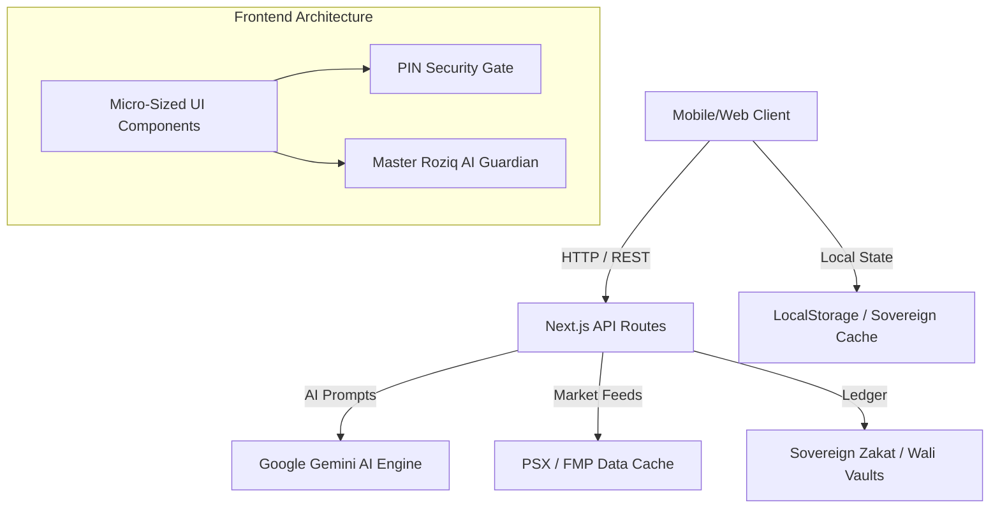
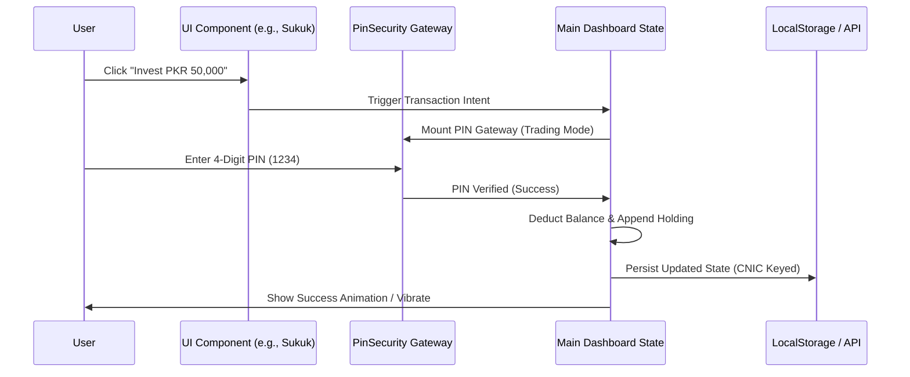

# 🏗️ Roziq Halal Wealth OS — Architectural & Implementation Plan

This document outlines the systematic engineering methodology, architectural patterns, state management flows, and production roadmap for the **Roziq Halal Wealth OS**.

---

## 1. 📐 Architectural Overview

Roziq is engineered as a highly modular, mobile-first Halal FinTech application. It employs a decoupled frontend-backend architecture utilizing Next.js 16 App Router for seamless server-side rendering (SSR) and optimized client-side interactivity.



---

## 2. 📱 Mobile-First "Micro-Sizing" Design System

To solve the common problem of "giant, unnavigable dashboards" on mobile screens, Roziq implements an aggressive **Adaptive Micro-Sizing** design system:

| Component Level | Traditional Styling | Roziq Micro-Sized Styling | Impact |
| :--- | :--- | :--- | :--- |
| **Container Padding** | `p-8` / `p-12` | `p-4 sm:p-6` | Maximizes viewport real estate on narrow screens. |
| **Typography** | `text-2xl` / `text-lg` | `text-base sm:text-lg` / `text-xs` | Prevents awkward word wrapping and vertical bloat. |
| **Action Buttons** | `py-6 px-10` | `py-3 px-5 sm:py-3.5` | Thumb-friendly without dominating screen height. |
| **Grid Gaps** | `gap-8` | `gap-3 sm:gap-4` | Tighter visual grouping for rapid scannability. |

---

## 3. 🔄 State Management & Data Flow

### Session & Identity Persistence
*   **CNIC Gating:** User identity is anchored to their verified Pakistani CNIC (`cnic`).
*   **Sovereign Local Storage:** To guarantee zero-latency offline demo capabilities during hackathon presentations, all core financial ledgers (Balance, Holdings, Transactions, Zakat History) are persisted in `localStorage` keyed by the user's CNIC (e.g., `roziq_balance_42101-1234567-1`).

### Transaction Processing Lifecycle


---

## 4. 🔒 Security & Authorization Model

1. **Dual-Mode PIN Architecture:**
   *   `trading` mode: Used for rapid authorization of stock/sukuk purchases.
   *   `auth` / `transfer` mode: Gated with higher timeout security for fiat deposits, withdrawals, and Zakat Vault routing.
2. **Sovereign Lockout:** The app automatically locks upon explicit user request or session termination, requiring CNIC/PIN re-verification.

---

## 5. 🤖 Master AI Guardian Integration

The AI Guardian operates as a context-aware financial mufti. When a user queries the agent, the client injects the user's live financial context into the system prompt securely:

```typescript
// System Prompt Context Injection Payload
const payload = {
  userBalance: 4500000,
  holdings: [{ symbol: 'SYS', invested: 100000, pnl: 25000 }],
  prompt: "Should I pay Zakat on my Systems Ltd shares?"
};
```
The Next.js backend (`/api/chat`) processes this alongside AAOIFI Standard No. 35 rules to formulate an authoritative Shariah response.

---

## 6. 🚀 Phase-by-Phase Future Scalability Roadmap

### Phase 1: Hackathon MVP (Current)
*   [x] Fully responsive mobile-first micro-sizing UI.
*   [x] Master AI Guardian with live wallet context.
*   [x] Sovereign Zakat Vault & Tathir purification engine.
*   [x] Wali AI Autopilot with 25 Crore elite entry barrier.

### Phase 2: Backend Database Migration (Post-Hackathon)
*   [ ] Replace `localStorage` with **Supabase / PostgreSQL**.
*   [ ] Implement Row Level Security (RLS) policies keyed by CNIC.
*   [ ] Set up Redis caching for real-time stock ticker prices.

### Phase 3: Native Mobile PWA Packaging
*   [ ] Utilize Next.js PWA manifests and **Capacitor / Bubblewrap** to compile a production-grade Android APK.
*   [ ] Implement native biometric authentication (FaceID/Fingerprint) as a fallback to the 4-digit PIN.

### Phase 4: Live Brokerage & Banking Integration
*   [ ] Integrate **EasyPaisa / JazzCash / Raast** payment gateways for real-world fiat on-ramps.
*   [ ] Connect live FIX/REST APIs with PSX brokers (e.g., AKD Securities, Arif Habib) for real-world automated trade execution.
