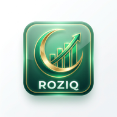

# 🇵🇰 Roziq — Pakistan's First Halal Wealth OS

<div align="center">
  
  <h3>Build wealth. Stay pure. Serve the Ummah.</h3>
  <p>
    
    
    
    
  </p>
</div>

---

## 🎯 What is Roziq?

Roziq is a **sovereign financial operating system** designed exclusively for Pakistan's Muslim community. It combines AI, real-time PSX data, and Islamic finance principles to provide an all-in-one Halal wealth management platform.

**Pakistan has 220M+ Muslims with zero dedicated Shariah-compliant fintech.** Roziq fills that gap.

---

## ✨ Core Features

### 🔐 Security First
- **Mandatory 1234 PIN** on every session launch (Master Key always works)
- Biometric (WebAuthn) integration for transaction approval
- CNIC-locked heir distribution in the inheritance engine

### 📈 Halal Stock Market (PSX)
- **Live PSX data** via Financial Modeling Prep API (60-second refresh)
- Algorithmic AAOIFI Shariah screening — removes all Riba/Gharar stocks
- Inline buy flow with real-time share quantity calculation

### 💳 Real Payment Integration
| Gateway | Type | Status |
|---------|------|--------|
| EasyPaisa | Mobile Wallet | ✅ Integrated (Sandbox) |
| JazzCash | Mobile Wallet | ✅ Integrated (Sandbox) |
| Meezan Bank | Bank Transfer | ✅ Integrated |
| HBL | Bank Transfer | ✅ Integrated |
| UBL | Bank Transfer | ✅ Integrated |

### 🤖 AI Engines
- **Mufti AI** — Voice-activated Shariah fatwa advisor (Google Gemini)
- **Wali Autopilot** — Elite AI trading guardian (unlocks at 25 Crore invested)

### 🏦 Sovereign Assets
- **Hajj Vault** — Riba-free savings towards pilgrimage
- **Agri-Financing** — Invest in Halal agricultural yields
- **Fractional Sukuk** — Islamic bonds from PKR 1,000

### 🤝 Social Finance
- **Digital Kameti** — 0% fee family ROSCA platform
- **Wirasat Engine** — Islamic inheritance calculator with CNIC heir-locks

### 🕋 Zakat Ecosystem
- Automated Zakat calculation (2.5% of eligible wealth)
- National Vault — distribute to Edhi, Shaukat Khanum, Saylani, Akhuwat
- Dividend Purification Tracker

---

## 🛠️ Tech Stack

| Layer | Technology |
|-------|-----------|
| Framework | Next.js 16 (App Router) |
| Language | TypeScript 5 |
| Styling | Tailwind CSS 3 |
| AI | Google Generative AI (Gemini) |
| Payments | EasyPaisa + JazzCash APIs |
| Market Data | Financial Modeling Prep (PSX) |
| Mobile | Capacitor 6 (Android/iOS) |
| Hosting | Vercel |

---

## 🚀 Quick Start

### 1. Clone and Install
```bash
git clone https://github.com/Ahsan-cyberexpert/pakistan-halal-investment.git
cd pakistan-halal-investment
npm install
```

### 2. Configure Environment
```bash
cp .env.example .env.local
# Edit .env.local with your API keys
```

### 3. Run Development Server
```bash
npm run dev
# Open http://localhost:3000
# PIN: 1234
```

---

## 📱 Mobile APK

The Android project is in the `android/` folder. To build:

1. Open **Android Studio**
2. File → Open → select `android/` folder
3. Build → Build APK(s)

> **Note:** Your Java version must be 17 or 21. If you have Java 24, use Android Studio's embedded JDK.

---

## 🌐 Environment Variables

See `.env.example` for all required keys:
- `GEMINI_API_KEY` — Mufti AI & Wali Autopilot
- `FMP_API_KEY` — Live PSX stock data
- `EASYPAISA_STORE_ID` + `EASYPAISA_HASH_KEY` — EasyPaisa live payments
- `JAZZCASH_MERCHANT_ID` + `JAZZCASH_PASSWORD` + `JAZZCASH_HASH_KEY` — JazzCash live payments

---

## 📁 Project Structure

```
src/
├── app/
│   ├── page.tsx              # Landing page
│   ├── dashboard/page.tsx    # Main app shell
│   ├── layout.tsx            # Root layout
│   └── api/
│       ├── psx/route.ts      # Live PSX market data
│       ├── transaction/      # Wallet engine
│       ├── payment/deposit/  # EasyPaisa + JazzCash
│       ├── payment/withdraw/ # Withdrawal processing
│       ├── agent/mufti/      # Mufti AI (Gemini)
│       ├── agent/autopilot/  # Wali AI engine
│       └── zakat/vault/      # National Zakat Vault
├── components/               # 33 modular components
└── lib/
    ├── db.ts                 # File-based wallet store
    └── halal-stock-data.ts   # PSX Halal stock list
```

---

## 🏆 Built for Hackathon

This project was built for the **Pakistan Fintech Hackathon 2026**. The mission: prove that cutting-edge AI and financial technology can serve the Muslim market without compromising on Shariah principles.

---

*Built with pride for Pakistan 🕌 — اللہ کے نام پر*
