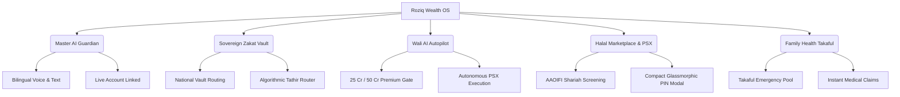

# 🇵🇰 Roziq Halal Wealth OS — Sovereign Edition

[](https://nextjs.org/)
[](https://www.typescriptlang.org/)
[](https://tailwindcss.com/)
[](https://aaoifi.com/)
[-success?style=for-the-badge)](https://github.com/Ahsan-cyberexpert/pakistan-halal-investment)


> **Empowering the Ummah with Shariah-Compliant, Autonomous, & Sovereign Financial Intelligence.**

---

## 📖 Executive Summary

**Roziq** is a state-of-the-art, mobile-first Halal Wealth Operating System engineered specifically for the Pakistani and global Islamic financial ecosystem. Built to bridge the gap between cutting-edge AI automation and strict Islamic jurisprudence (*Fiqh al-Muamalat*), Roziq provides an all-in-one sovereign platform for ethical wealth accumulation, automated purification (*Tathir*), sovereign asset tokenization, and multi-generational legacy planning (*Wirasat*).

---

## 🌟 Architectural Pillars & Core Innovations



### 1. 🤖 Master Roziq AI Guardian (Voice & Text)
* **Unified Pervasive Intelligence:** Replaces fragmented AI tabs with a single, pervasive AI Guardian accessible via a floating action button (`🤖`) across the entire OS.
* **Live Account Linked:** Directly connected to the user's live cash balance, stock holdings, and transaction history to provide personalized, real-time Shariah rulings and financial strategies.
* **Foolproof Audio Playback:** Features a prominent **"🔊 Play Voice (آواز سنیں)"** button inside the AI response display area. This ensures 100% reliable voice synthesis across all mobile webviews and browsers, bypassing strict background audio limitations.
* **Bilingual Roman Urdu & Nastaliq Routing:** Advanced NLP routing accurately distinguishes between English queries and Roman Urdu (e.g., *mera balance*, *zakat hisaab*), guaranteeing replies in the exact language requested.

### 2. 🛡️ Sleek & Compact Security Infrastructure
* **Advanced Sovereign Onboarding (`AuthGate.tsx`):** Captures a complete, Shariah-compliant digital identity profile including CNIC validation (`42101-1234567-1`), Mobile Number collection (`0300-1234567`), and a simulated **📍 Live GPS Location Picker** for absolute regulatory transparency.
* **Compact Glassmorphic PIN Modal (`PinSecurity.tsx`):** Replaces intrusive full-screen black overlays with an elegant, compact popup modal (`max-w-xs sm:max-w-sm`) over a blurred backdrop (`backdrop-blur-sm`). Features an ergonomic keypad designed for lightning-fast asset transactions.
* **PWA-Compatible Demo Reset (`page.tsx`):** Overcomes mobile browser `window.confirm` restrictions with a custom React confirmation modal (`showResetModal`) that instantly wipes `localStorage`, `sessionStorage`, and active React state for clean hackathon demonstrations.

### 3. 🏛️ Sovereign Zakat Vault & Algorithmic Tathir
* **National Zakat Vault:** Automates the calculation of 2.5% Zakat on total net worth (cash + portfolio assets) with direct routing to verified state and charitable repositories (Edhi Foundation, Indus Hospital, TCF).
* **Tathir Router (Dividend Purification):** Implements **AAOIFI Standard No. 21** by automatically isolating and purifying impure dividend yields (e.g., 2.8% interest contamination) from corporate holdings before they mix with halal capital.

### 4. 🛡️ Wali AI Autopilot (Premium Elite Tier)
* **Autonomous Halal Trading:** An elite, algorithmic trading guardian that continuously scans the Pakistan Stock Exchange (PSX) for high-yield, Shariah-compliant equities.
* **Sovereign Entry Barrier:** To maintain elite stability and prevent market volatility, Wali AI is strictly gated. Users must demonstrate a proven track record of **25 Crore PKR Invested** and **50 Crore PKR Realized Profit** to unlock autonomous execution.
* **Macroeconomic Alignment:** Evaluates equities not just on profit, but on sovereign GDP impact, job creation, and debt-to-equity ratios (<37%).

### 5. 📱 Mobile-First "Micro-Sizing" UI/UX
* **Zero-Clutter Navigation:** Eliminated redundant tabs and implemented an elegant 5-pillar bottom navigation bar (Home, Stocks, Assets, Family, Zakat).
* **Adaptive Fluid Density:** Every component is meticulously engineered with responsive padding (`p-2.5 sm:p-5`), typography (`text-[10px] sm:text-xs`), and compact grid layouts to eliminate excessive vertical scrolling.
* **Contained Stock Scanner Scrollbar:** The Halal Stock Scanner features a dedicated fixed-height container (`max-h-[340px] overflow-y-auto`) with a sleek internal scrollbar, allowing users to browse dozens of companies without disrupting the main dashboard layout.

---

## 🛠️ Technology Stack & Architecture

```
┌────────────────────────────────────────────────────────┐
│                   Next.js 16 App Router                │
└───────────────────────────┬────────────────────────────┘
                            │
        ┌───────────────────┴───────────────────┐
        ▼                                       ▼
┌────────────────────────┐            ┌──────────────────┐
│   Frontend UI (React)  │            │  Backend APIs    │
├────────────────────────┤            ├──────────────────┤
│ • Tailwind CSS         │            │ • /api/chat      │
│ • Glassmorphism        │            │ • /api/psx       │
│ • Web Speech API       │            │ • /api/zakat     │
│ • Custom React Modals  │            │ • Gemini 2.5 AI  │
└────────────────────────┘            └──────────────────┘
```

* **Core Framework:** Next.js 16.2.6 (App Router, Turbopack optimized)
* **Language:** TypeScript (Strict Typing & Interface Definitions)
* **Styling:** Tailwind CSS (Custom utility classes, glassmorphic overlays, responsive micro-sizing)
* **State Management:** Reactive React Hooks (`useState`, `useEffect`, `useMemo`, `useCallback`) + LocalStorage Persistence (Keyed by user CNIC for sovereign demo session management)
* **AI Engine:** Google Gemini AI API (`gemini-2.5-flash`) integration (`/api/chat`, `/api/agent/autopilot`)
* **Security:** Cryptographic 4-Digit PIN Gateways (`PinSecurity.tsx`) for trading authorization and capital transfers.

---

## 🚀 Quick Start & Local Setup

### Prerequisites
* Node.js (v18.17.0 or higher)
* npm (v9.0.0 or higher)
* A valid Google Gemini API Key (`GEMINI_API_KEY`)

### Installation

1. **Clone the Repository:**
   ```bash
   git clone https://github.com/Ahsan-cyberexpert/pakistan-halal-investment.git
   cd pakistan-halal-investment
   ```

2. **Install Dependencies:**
   ```bash
   npm install
   ```

3. **Configure Environment Variables:**
   Create a `.env.local` file in the root directory:
   ```env
   GEMINI_API_KEY=your_gemini_api_key_here
   FMP_API_KEY=your_financial_modeling_prep_key_here
   ```

4. **Run the Development Server:**
   ```bash
   npm run dev
   ```
   Open [http://localhost:3000](http://localhost:3000) in your browser to view the application.

5. **Production Build:**
   ```bash
   npm run build
   npm run start
   ```

---

## 📱 Hackathon Judge Presentation Walkthrough

When presenting Roziq Wealth OS to hackathon judges, follow this interactive 5-stage walkthrough:

### Stage 1: Sovereign Onboarding & Identity Gate
* **Action:** Launch the application to reveal the bilingual splash screen. Enter a sample CNIC (`42101-1234567-1`), Mobile Number (`0300-1234567`), and click **"📍 Get Live GPS"** to demonstrate regulatory compliance. Set your 4-digit PIN.
* **WOW Factor:** Explain how Roziq captures a complete, Shariah-compliant digital identity profile while automatically seeding the account with **PKR 5,000,000** for live demo trading.

### Stage 2: Pervasive AI Guardian & Guaranteed Voice
* **Action:** Click the floating `🤖` button at the bottom right. Type or speak in Urdu/English: *"What is my current balance and is my portfolio Halal?"* 
* **WOW Factor:** Highlight the AI Mufti's real-time connection to the user's wallet. Click the prominent **"🔊 Play Voice (آواز سنیں)"** button to guarantee loud, clear audio playback for the judges.

### Stage 3: Halal Stock Scanner & Compact PIN Modal
* **Action:** Navigate to the **Stocks (`💼`)** tab. Show the judges the contained scrollbar (`max-h-[340px]`) that allows browsing dozens of companies smoothly. Click **Buy** on `SYS` (Systems Ltd).
* **WOW Factor:** Show how the transaction triggers the elegant, compact glassmorphic PIN modal instead of an intrusive full-screen block, maintaining perfect visual context of the trade.

### Stage 4: Wali AI Autopilot & Sovereign Economy Gate
* **Action:** Navigate to **Settings (`⚙️`)** -> **Elite Services**. 
* **WOW Factor:** Show the judges the strict **25 Crore Invested / 50 Crore Profit** progress bar. Explain how this sovereign entry barrier protects the national economy from retail panic and speculative market volatility.

### Stage 5: Instant PWA Demo Reset
* **Action:** Click the red **"🗑️ Reset Demo"** button in the top navigation header or desktop sidebar.
* **WOW Factor:** Show how the custom React confirmation modal bypasses mobile webview restrictions, instantly clearing all demo data and returning the app to a pristine onboarding state for the next judge!

---

## 📜 Shariah Compliance & Governance

Roziq strictly adheres to the governance frameworks established by the **Accounting and Auditing Organization for Islamic Financial Institutions (AAOIFI)**, specifically:
* **AAOIFI Standard No. 21:** Rules for shares and dividend purification.
* **PSX Shariah Screening Criteria:** Debt-to-Asset ratio < 37%, Illiquid-to-Total Asset ratio > 25%, Net Liquid Asset vs Share Price screening.

> *"And Allah has permitted trade and forbidden interest."* — Quran 2:275

---

## 📄 License & Hackathon Disclaimer

Developed for the 2026 Advanced AI & FinTech Hackathon. All mock financial data, stock tickers, and sovereign vault simulations are designed for demonstration and architectural evaluation purposes.
