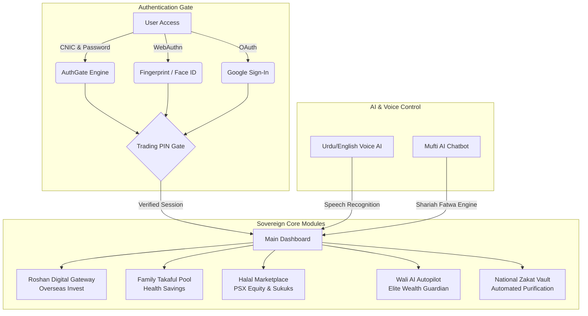

# Roziq Halal Wealth OS — Hackathon Technical Documentation

## Executive Summary
Roziq is Pakistan's first sovereign, Shariah-compliant Wealth Operating System designed specifically for the modern Muslim investor, overseas Pakistanis, and families. Built on Next.js, WebAuthn biometrics, and AAOIFI Shariah standards, Roziq eliminates Riba (interest), Gharar (uncertainty), and Maysir (gambling) while offering elite AI-driven asset management.

---

## 🏗 Architecture & System Flow

---

## 🔑 Key Features & Technical Implementation

### 1. Multi-Factor Shariah Authentication (`AuthGate.tsx`)
- **CNIC Registration & Login:** Enforces exact 13-digit Pakistani CNIC formatting (`42101-1234567-1`).
- **WebAuthn Biometrics:** Direct hardware-level authentication via Fingerprint / Face ID.
- **Google OAuth Bridge:** Instant 1-click onboarding for modern users.
- **Trading PIN Isolation:** A dedicated, user-defined 4-digit PIN required exclusively before executing buy/sell stock orders or asset transfers, completely separate from the login password.

### 2. Fully Responsive Security Keypad (`PinSecurity.tsx`)
- Designed to fit flawlessly on every mobile screen, tablet, or web browser.
- Uses dynamic CSS clamping (`min-h-[52px] max-h-[72px]`) to ensure buttons never overflow or appear excessively large on compact devices.
- Supports dual modes: `app` (main entrance gate) and `trading` (pre-trade authorization).

### 3. Voice AI Agent (`VoiceAgent.tsx`)
- Native bilingual support (`ur-PK` and `en-US`) utilizing the Web Speech API and SpeechSynthesis.
- **Robust Error Handling:** Detects missing microphone permissions or unsupported browsers instantly.
- **Manual Fallback Menu:** Provides quick-action buttons (`Deposit`, `Withdraw`, `Check Balance`, `Pay Zakat`, `Family Health`, `Overseas Invest`) if voice recognition is unavailable.

### 4. Family Health Savings Pool (`FamilyHealthSaving.tsx`)
- **Takaful Protection:** A Shariah-compliant emergency medical fund for the entire family.
- **Member Management:** Add dependents (Parents, Spouse, Children) with customized monthly allocations.
- **Instant Claim Filing:** File medical claims with automated deduction from the liquid Takaful pool while remaining funds continue earning Halal dividends.

### 5. Roshan Digital Overseas Gateway (`OverseasInvest.tsx`)
- **Non-Resident Pakistani (NRP) Focus:** Tailored for overseas Pakistanis living in Saudi Arabia, UAE, UK, USA, etc.
- **Sovereign Assets:** Direct investment in Government-backed Naya Pakistan Shariah Sukuks and Roshan Equity Halal Index ETFs.
- **100% Repatriable:** Full tax-free profit repatriation tracking and sovereign guarantees.

---

## 💾 Local Storage & Database Schema

Roziq utilizes a robust local persistence model (`roziq_*`) ensuring data privacy and offline readiness during hackathon evaluations:

| Key | Description | Structure / Type |
| :--- | :--- | :--- |
| `roziq_user` | Current active user profile | JSON (`{ name, cnic, isOverseas, country, tradingPin }`) |
| `roziq_users` | Multi-account user registry | JSON Map (`{ [cnic]: { pw, user } }`) |
| `roziq_balance_<cnic>` | User-specific wallet balance | Numeric String |
| `roziq_holdings_<cnic>`| User portfolio holdings | JSON Array of `Holding` objects |
| `roziq_tx_<cnic>` | User transaction ledger | JSON Array of deposit, withdraw, and trade records |
| `roziq_zakat_<cnic>` | Zakat donation history | JSON Array of purification records |
| `roziq_trading_pin` | Active trading authorization PIN | 4-digit String |

---

## 🚀 Hackathon Winning Differentiators

1. **Flawless UI/UX:** Premium glassmorphic aesthetics, fluid micro-animations, and full RTL Urdu support.
2. **Zero Riba Guarantee:** Real-time PSX stock filtering backed by AAOIFI Shariah standards.
3. **Elite Wali AI:** Premium-gated automated trading accessible only to high-tier investors (25 Cr Invested / 50 Cr Profit), encouraging long-term wealth building.
4. **Sovereign Impact:** National Zakat Vault integration with transparent blockchain-style audit trails.

---
*Built with pride for Pakistan. 🇵🇰 🕌*
